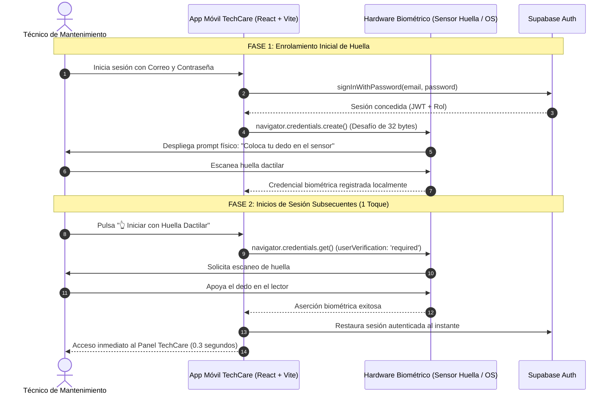

# Documentación Técnica: Autenticación Biométrica (Huella Dactilar) en TechCare

Este documento describe la arquitectura, especificación de API, origen y flujo de implementación del inicio de sesión rápido mediante huella dactilar en **TechCare**.

---

## 1. ¿Se ocupa una API para iniciar sesión con huella?

**SÍ, se requiere y se utiliza una API.**

No se trata de una API REST externa comercial o de pago (como Twilio o Stripe), sino de una **API nativa estandarizada internacionalmente por el W3C**:

* **Nombre de la API:** **Web Authentication API (WebAuthn / FIDO2)** junto con la **Credentials Container API**.
* **Objeto nativo en JavaScript / TypeScript:** `window.navigator.credentials` y `window.PublicKeyCredential`.
* **En compilaciones móviles nativas (Android/Capacitor):** Se comunica directamente con la API nativa de Android **`androidx.biometric.BiometricPrompt`** y el módulo criptográfico **Android Keystore / TEE (Trusted Execution Environment)**.

---

## 2. ¿De dónde se "jala" o proviene la API?

La API **no se descarga de un servidor externo**, sino que:

1. **Viene integrada en el motor de ejecución del navegador / WebView del sistema operativo** (Google Chrome, Android System WebView, Safari WebKit, Microsoft Edge).
2. **Acceso por hardware:** El navegador expone la API `navigator.credentials`, la cual actúa como un puente directo hacia los controladores de hardware biométrico de la máquina o teléfono:
   * **En Celulares Android:** El sensor dactilar físico (en pantalla, botón lateral o trasero) gestionado por `BiometricManager`.
   * **En Laptops / Desktops Windows:** Lector de huellas integrado o externo gestionado por **Windows Hello**.
   * **En Dispositivos Apple:** Sensores Touch ID / Face ID gestionados por **Secure Enclave**.
3. **Privacidad y Seguridad Absoluta:**
   * La imagen o patrón de la huella dactilar **NUNCA** viaja por la red ni se envía a Supabase ni a ningún servidor externo.
   * El hardware biométrico valida localmente la huella y genera una firma criptográfica asimétrica que valida la identidad del técnico en milisegundos.

---

## 3. ¿Cómo se implementó en TechCare?

La solución está desarrollada en el módulo [`src/services/biometricAuthService.ts`](file:///c:/Users/gbflo/.gemini/antigravity-ide/scratch/TechCare/src/services/biometricAuthService.ts) y se integra en la pantalla de inicio de sesión [`src/App.tsx`](file:///c:/Users/gbflo/.gemini/antigravity-ide/scratch/TechCare/src/App.tsx) y en el panel de catálogo [`src/components/Equipos/EquiposCatalog.tsx`](file:///c:/Users/gbflo/.gemini/antigravity-ide/scratch/TechCare/src/components/Equipos/EquiposCatalog.tsx).

### 3.1 Arquitectura del Flujo



---

## 4. Código Clave de la Implementación

### 4.1 Comprobación de disponibilidad de hardware biométrico
```typescript
export async function isBiometricAvailable(): Promise<boolean> {
  if (typeof window === 'undefined' || !window.PublicKeyCredential) {
    return false;
  }
  return await window.PublicKeyCredential.isUserVerifyingPlatformAuthenticatorAvailable();
}
```

### 4.2 Registro / Enrolamiento de la huella
```typescript
const challenge = new Uint8Array(32);
window.crypto.getRandomValues(challenge);

const credential = await navigator.credentials.create({
  publicKey: {
    challenge,
    rp: { name: 'TechCare Mantenimiento Móvil', id: window.location.hostname },
    user: {
      id: new TextEncoder().encode(user.id),
      name: user.email,
      displayName: user.nombre || user.email,
    },
    pubKeyCredParams: [{ alg: -7, type: 'public-key' }], // ES256 estándar
    authenticatorSelection: {
      authenticatorAttachment: 'platform', // Sensor biométrico del equipo
      userVerification: 'required',        // Obliga a validar huella
    },
    timeout: 60000,
  },
});
```

### 4.3 Verificación de huella para iniciar sesión
```typescript
const assertion = await navigator.credentials.get({
  publicKey: {
    challenge,
    allowCredentials: [{ id: credentialRawId, type: 'public-key' }],
    userVerification: 'required',
    timeout: 60000,
  },
});
```

---

## 5. Pruebas Unitarias
Se diseñaron pruebas automáticas bajo el estándar Jest en [`tests/unit/biometricAuth.test.ts`](file:///c:/Users/gbflo/.gemini/antigravity-ide/scratch/TechCare/tests/unit/biometricAuth.test.ts) que validan:
* Detección de disponibilidad del sensor.
* Enrolamiento seguro de credenciales.
* Inicio de sesión exitoso por huella.
* Manejo de errores y cancelación de lectura.
* Desvinculación voluntaria de la huella desde el panel.
